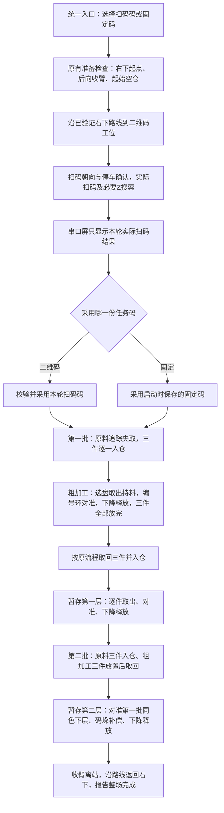

# 统一比赛任务流程设计

日期：2026-10-12。状态：需求与设计文档，运行代码尚未按本设计集成。本轮只更新规则、现行说明和实施计划，不烧录或发送实车命令。依据为本次用户需求、两次补充答复、[AGENTS.md](../../../AGENTS.md)及当前源码；单项验收以用户明确报告为准。

## 1. 需求理解与验收边界

目标是把已经能单独完成的动作串成一场连贯的比赛：用户在一个入口选择任务码依据、启动，设备完成移动、识别和取放；网页展示当前阶段，并能停止和继续。用户之前手动往夹爪装料、手动下降和松爪，是单项验证方法，不是正式流程必须保留的人工步骤。

| 用户报告的单项 | 统一流程中的用途 | 当前需要补齐的衔接 |
|---|---|---|
| 右下起点到二维码并扫码 | 正式比赛第一段 | 与完整路线共享同一次定位及路线所有权 |
| 准备抓取姿态、夹取物料 | 原料三件获取 | 通过C接口进入已联调的反馈追踪夹取 |
| 夹取后入料盘：尚未测试 | 原料/加工取回入仓 | 删除旧伸X规则，先验证三个仓的实际放料 |
| 指定盘取出、持料转128° | 从车仓送向工位 | 保留闭爪，接入持料视觉对准；最新保持X收回版本仍应复核 |
| 编号环对准 | 粗加工/暂存第一层定位 | 不能打开已持料夹爪，不能只按地图坐标放料 |
| 对准后人工装料、下降、松爪 | 自动下降释放、提起退出 | 物料由车仓自动取出提供，取消人工再装料步骤 |
| 码垛类似验证 | 暂存第二层同色码垛 | 衔接持料状态、同色下层目标、二层实际高度 |

这份设计不把整场成功标为已验证，也不把已有代码中使用100 mm车仓伸X的路径当作已确认几何。

## 2. 已明确的关键取舍

1. 两种任务码来源：实际二维码、用户设置的固定码。两者都实际去扫码工位扫描。
2. 用户确认串口屏只显示本轮实际扫描结果；固定码只影响执行。网页/控制台分别显示“实际扫码结果”“本轮执行依据及任务码”，便于理解两者不同。
3. 用户确认入仓也保持X收回，Base回车仓后竖直放料，明确删除旧`x_car`参数。其他工位的X视觉运动及外侧观察位置不因此删除。
4. 空夹原料准备到Base参考+128°后可开爪2500 µs；带料取出转128°后保持1920 µs闭爪。持料对准不得复用自动开爪的空夹准备。
5. 首版复用反馈追踪组的现有配置，不重新调lambda/速度/预测模型。原预测及纯视觉单项入口保留。
6. 比赛在STM32内调度，网页不根据`picked`日志再串发若干运动命令，也不靠浏览器定时器等待1秒。

## 3. 一场比赛的连续流程

起点继续为车体中心(2250,150)、yaw−180°；先保持朝向斜移到(2100,300)，再顺时针转90°，沿右侧通道到二维码接近点(2100,qr_scan_y)。扫码转向复用单项验证，完成时的实际yaw交给下一段，不恢复成虚假的出发yaw、不重新设置地图原点。完整路线在二维码站交接/继续，不能先跑“二维码独立测试”到终点，再从二维码位置调用要求车辆仍在右下起点的整条路线启动函数。

扫码段保留独立测试默认50 mm/s、Z搜索5 mm/s及现有高度配置；其他路线保留原200 mm/s初值和工位接近限速，可在统一入口分别设置路线速度、扫码段速度，不借集成任务统一改变已验证运动参数。

工位外侧粗定位只把物料送到可视觉对准的位置，不替代实际编号环/同色下层对准。视觉微调改变的车体位置由反馈定位连续记录；离站先提起收臂，保持作业车体朝向退到允许转身的接驳位置，再转向下一段。完整车体投影、180°转向方向、白色禁区和外侧接驳按AGENTS既有规则检查，不能只检查中心点。

## 4. 任务码、扫码与显示分离

### 数据归属

| 数据 | 来源与生命周期 | 用途 |
|---|---|---|
| `ScannedCode` | 本轮扫码会话的真实UART新帧，在扫码阶段采集 | 串口屏任务码、网页扫码结果 |
| `FixedCode` | 用户启动前明确设置，接受启动时复制 | 固定来源模式的执行候选码 |
| `ExecutionCode` | 来源选择后一次采用并译码 | 两批颜色、环号及同色下层位置 |
| `Colors/Rings/FirstRing` | 从ExecutionCode建立，本轮持有 | 搬运调度，不能从不断变化的QR共享缓存重新读取 |

沿用当前`DDD+DDD+DDD+DDD`四组三位、15字符格式，首批颜色/环号、次批颜色/环号的语义与现有`decode()`一致。采用码要求颜色在1～6、环号1～3，每批不重复、两批颜色集合一致。固定码在出发前校验；扫码码在实际取得后校验，不采用旧缓存、模拟码或默认回退码。

两种模式都先前往二维码工位，完成真实扫码及屏幕发送交接，才正常进入原料流程。记录扫码会话开始时的序号，复用已验证独立扫码“本轮UART新帧”语义；同样字符串的新帧也有效。接近途中已取得本轮真实码时仍要完成扫码工位的到位/朝向/停车交接，不能提前跳过工位。一次Z上下搜索没有结果后保持等待；短时波动和后续新帧可以恢复，人工停止不会自动续跑。固定模式也不能用固定码显示来代替真实扫码。

真实扫码模式：格式合法但任务顺序无法译码时，屏幕仍显示真实扫描内容，任务原地等待有效新码/明确修正；不启动错误搬运。固定模式：扫描结果可以与固定执行码不同，不因这种差异终止；实际扫描内容负责显示，合法固定码负责执行。

显式开始新比赛时清空串口屏上一轮任务码显示，待本轮真实结果再刷新既有`main.tTaskTop/tTaskBottom`，不新增HMI控件或把固定码写入其中。`TaskCodeSent()`只表示屏幕DMA发送完成，不声称已测得屏幕实际渲染；发送问题显示具体原因，在对应阶段等待恢复，不能因一次屏幕忙丢失整场上下文。

源码需同时处理两个入口：`contest_mission.c`目前会用执行Code刷新屏幕；`main.c`目前会在每次QR共享缓存更新时显示并清零抓放计数。新流程中屏幕码由本轮实际扫码管理，计数只在显式开始新场时清零；重复UART帧不能重置搬运进度，`QR_SimulatedSet()`不能用于设置正式固定执行码。

## 5. 抓取、入仓、取出与持料放置

### 原料夹取及入仓

空夹准备+128°并开爪 → 请求本件颜色DX/DY → 反馈追踪夹取 → 提起 → X回x_min → ID8分度到指定仓并确认 → Base回实际后向参考 → X继续保持x_min → 按入仓配置下降 → 松爪及原等待 → 记录入仓 → 提起收臂 → 返回原料观察姿态。

夹取仍采用当前±50 px下降启动窗口、±100 px闭爪窗口、最小10 ms新视觉保持、Z−50 mm及原下降速度；这些是当前配置初值，实际RAM须读回。结果`picked`只证明夹取阶段的软件动作完成，不能作为入仓完成；只有释放/提起/库存及返回链完成后`stored`才推进下一件。

彻底移除`C_X_CAR`/`x_car`：参数定义、准备校验、回零恢复、位移目标、网页元数据/字段、预设/提示、测试与活动手册一并修改。不能长期留下一个必须填写为0的旧参数。所有车仓入/出动作按回零X位置管理，外部视觉对准的X行程保留。历史记录保持原事实；本轮文档更新不表示设备RAM或固件已经删除该参数。

入仓下降/抬升仍独立可调；现有`track_store_drop_mm=60`仅软件预设，不能由“取出下降40 mm”反推真实放料高度。用户明确该动作未测，三仓专项是整场验收前的第一项实车补测。

### 车仓取出并持料

复用已修正的手动取盘链：X收回、ID8先分度、Base回后向参考、等待1秒、默认下降40 mm闭爪、等量提起、X保持收回、Base+128°，完成`picked`并保持物料。手动入口不要求颜色/库存登记；正式调度从ExecutionCode和已完成入仓记录知道取哪件，不能把手动入口恢复成逐盘登记颜色的步骤。

### 持料编号环/第一层放置

先到工位外侧粗定位，再取出目标仓并持料+128°；以目标环号启动持料对准。复用当前编号环视觉参考(378,333)、渐进Z对准及停车反馈，但保留夹爪闭合、不执行人工装料等待、不重复“空夹准备开爪”。对准完成后由同一机构状态机继续下降到相应工位放置Z，松爪、等待、提起退出，完成`released`后才计一次放置。

### 加工取回与二层码垛

每批粗加工三件先全部放完，再按已放置记录回到对应环取回入仓；此阶段先视觉重新对准加工物料，再闭爪提起，不使用过期的上一件对准坐标。

第一批暂存位置记录成`颜色→位置/环号`。第二批码垛先取出持料，视觉请求同色下层物料的DX/DY，接入用户已验证的码垛对准和39/−1像素补偿，只在第二层码垛中启用；不写准心、不扩散到粗加工。最终Z由实际下层高度及已验证设置确定，不按名义赛题尺寸代填。

工位Z配置沿用`z_proc_place`、`z_temp_place`、`z_stack_place`、加工取回高度，必要的新持料对准高度在`grab_parameters.def`维护。尚无实测值的字段保持未设置；只在即将使用时进入`config_wait`，补齐后继续当前件，不能重做已经成功的入仓或放置。

## 6. 所有权、进度和中断

`ContestMission`管理比赛顺序、采用码、批次/件/仓位及完成计数；`ChassisRoute`管理连续路径、工位交接与实际反馈姿态；`GrabTask`管理抓取、入仓、持料对准释放及机构完成确认。正式父任务调用C接口，不绕到ASCII命令处理器，不把HOLD的正常对准占用误判为无法接续的忙。

每件上下文保存颜色、仓位、目标环/下层颜色、取料/放料高度及已下达闭爪/松爪阶段。视觉识别目标与夹爪实际持料颜色分离：对环的B2目标不能改掉所持物料身份。沿用Stored/Placed各12次软件入仓/外部释放的计数口径，避免将`picked`重复计作`stored`；没有新增夹持传感器，动作记录不宣称物体检测结果。

停止：先请求四轮/Base/X/Z/ID8停车并保持夹爪输出，记录当前阶段；确认后显示暂停，保留任务码、路线接驳目标、批次/件和库存。显式继续从实际停下的位置和阶段续接；夹爪已闭合不重抓、已松爪不再投料、记账完成不重复计数。现有`ContestMission_Stop()`的CANCELLED和仅config_wait可continue行为需要补成正式任务的暂停/续接，不仅改变按钮文字。

普通重连、解除停车锁不启动任务或重放命令。总线恢复后局部重新取得需要的反馈，真正改变原点只作废相关参考；不能恢复时说明具体原因及局部操作，不强制全部回零重跑。需要人工校正持料/库存时在统一入口呈现相应阶段，不清空全部已完成记录。

## 7. 统一上位机入口

“视觉任务 → 比赛任务”作为正式入口，包含任务码来源、固定码（仅固定来源启用）、路线/扫码段速度、当前场景高度、开始比赛、读取状态、停止、继续当前阶段。开始前展示右下起点/回零状态、所选来源及起始仓位；需要实际起始空仓确认时在本入口一次完成，不要求三次颜色登记或跳转多个页面。

状态首屏显示本轮实际扫码结果、采用执行码及来源、批次/当前件/目标仓或环、当前动作与下一动作、等待原因和停止确认；完整诊断展开查看。单项二维码、动态追踪、取放、环和码垛入口保留，正式任务拥有机构时按现有占用规则操作；停止和状态查询始终可用。

固定码输入、模式切换、刷新、重连、保存草稿不发运动。点击开始把选择交给固件，一次开始命令后固件自主推进；任务开始后改变草稿不改本轮执行码。

## 8. 当前源码缺口与实施边界

| 位置 | 现状 | 所需变更 |
|---|---|---|
| contest_mission.c | 码缺失时模拟默认码；开始就译码；QRCode站直接通过 | 来源选择、真实扫码与显示交接、执行码独立冻结 |
| chassis_route.c/profile | TaskRoute只交接原料/加工/暂存；QR独立测试另起路线 | 同一路线QR交接、扫码姿态、扫描后实际yaw连续续跑 |
| GrabRoute.c | 独立真实扫码已具备，正式mission参数未区分来源 | 暴露新正式启动参数，保持单项测试隔离 |
| GrabTask.c | 追踪入仓/持料取出已有；API主要仍静态raw；持料对准会复用开爪准备 | C调用入口、去除车仓伸X、持料视觉对准与连续释放 |
| main.c/contest_screen.c | 共享QR更新会改显示并清进度；mission会显示执行Code | 本轮实际扫码显示所有权、清空旧显示、重复码不重置进度 |
| 网页 | 各单项入口及旧两批按钮 | 一个完整比赛入口，明确实际码与执行依据 |

不新增调度框架、RTOS、后台浏览器脚本或重新改控制算法。不改变GPIO/时钟/HAL、官方驱动、EIDE或独立F103；当前工作区已有其它聊天的雷达盘舵机/网页改动，实施时保留。固定与雷达路线均沿既有车体投影规则，不能标为已完成全部扫掠验收。

## 9. 验收顺序

1. 软件：完整动作链、码来源/显示、旧缓存/重复扫码、局部缺项/恢复、所有关键阶段停止续接、状态与网页被动行为；原单项回归保留。
2. 实车先验证X收回的三个仓入仓及返回，确认高度与记录一致。
3. 验证车仓取出持料→编号环对准→下降释放，以及二层持料码垛；不人工再装料。
4. 验证两种来源均实际扫码、屏幕仅实际码，真实码和固定执行码可以不同。
5. 验证第一批完整循环，再验证两批连续及回起点；在行驶/追踪/入仓/出仓/对准/松爪后分别测试停车续接。

尚需现场读回/记录：入仓下降高度、各工位对准/释放高度、加工取回高度和二层高度。来源/屏幕/X规则已由用户明确，实施不再重新询问；上述数值未知不阻止本轮设计与软件计划完成。
