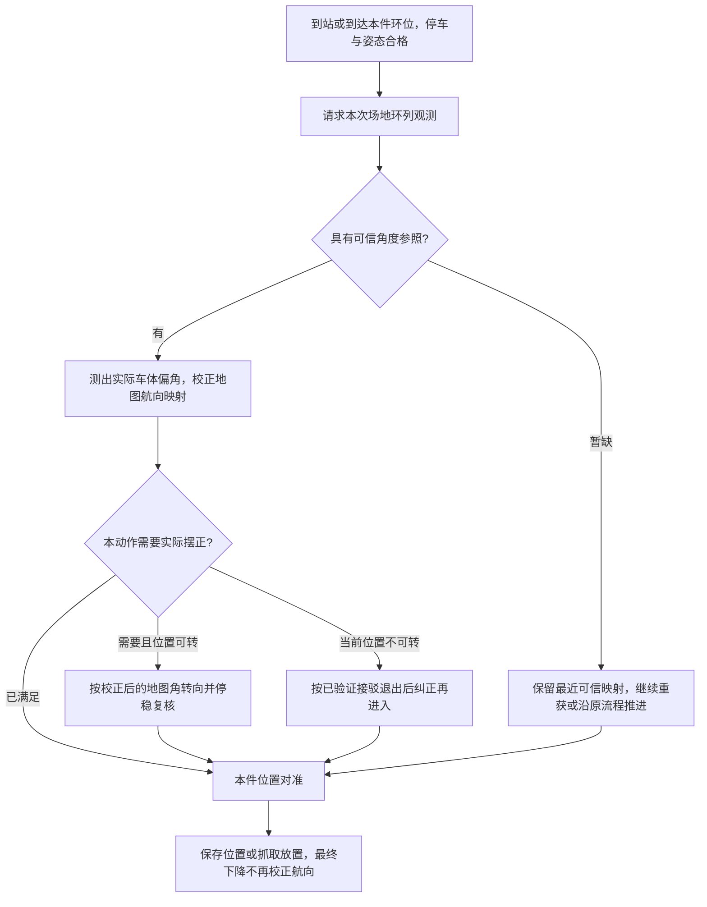

# 色环参照校正地图航向方案

日期：2026-10-14。状态：用户随后授权实施；软件分支已接通并完成验证及STM32下载校验，实车尚未标定，开启后只观测。两份视觉程序保留，香橙派未部署。结果见[实施记录](../../开发记录/2026-10-14-比赛视觉航向分支实现与验证.md)。

## 1. 本次需求与关键修正

用户确认IMU陀螺仪测角准确。问题是人工摆车时，实际朝向与软件赋予的地图角度有偏差：例如实际0.5°被绑定为0°，即使后续相对转角和直行保持都准确，仍沿错误方向运行。本方案不把该问题归因于IMU漂移，也不重新调整已验证的IMU/电机方向。

目标：每次到加工区、暂存区色环作业点，都安排利用场地固定环列方向核验地图航向的机会；获得合格参照后，修正当前IMU角度到地图角度的对应关系，并让修正持续服务后续换环、加工取回、码垛、离站和返程。

成功标准是实际地图行驶方向改善、任务连续完成，而不是只把界面数字改成180°或90°。视觉无有效角度时保留最近可信参照，明确本次未更新，不把“到站”本身当作摆正证据。

用户随后要求：本功能先作为“比赛任务”中的可选测试分支，与原比赛流程对齐。设计默认关闭，保留当前流程；开启后本轮锁定，与现有raised/lowered对准高度选项独立。具体修改次序见[比赛视觉矫正分支修改计划](../plans/2026-10-14-比赛视觉矫正分支修改计划.md)。该开关已写入网页和固件；未标定时不修改地图角、不自动转车。

本方案细化并更新[新版视觉收录分析](../../开发记录/2026-10-14-新版视觉代码收录与工位校准接入分析.md)中的局部工位建议：**场地坐标轴和工位方向固定，应校正全车共用的航向映射；不要旋转场地环位来迁就摆车偏差，也不要将校正仅保存在本次工位。**

## 2. 已知坐标、方向和可观察量

| 对象 | 已确认约定 / 当前代码 |
|---|---|
| 地图 | 左下原点，X向右、Y向上；0°向右、90°向上、180°向左、−90°向下 |
| 底盘转向 | 正角速度俯视逆时针；IMU方向系数+1 |
| 右下 / 右上起始名义航向 | 180° / −90°，摆放存在的小偏角正是本方案要校正的量 |
| 物料台作业航向 | 0°；动态物料不是本次固定色环航向参照 |
| 加工区 | 作业航向180°，环1→环3沿地图−X，环列轴线水平 |
| 暂存区 | 作业航向90°，环1→环3沿地图+Y，环列轴线竖直 |
| Base | 正相对角俯视顺时针；作业原参考+128°朝车体正左，扫码+35°，不混入地图yaw |
| 新视觉0D | 图像中三个环心按X排序，输出中环EX/EY和连线图像角；不是地图yaw，不识别赛场环号 |

单独一个圆心或DX=DY=0不足以证明车体方向正确：圆心是位置约束，圆形本身具有旋转对称性。本轮优先使用两处固定环列的方向，其中新源码实际要求三环同时可见。不能将物料顶面的摆放角、夹爪角度或单环像素归零冒充场地航向基准。

环列直线本身只有模180°的方向。利用当前工位、已知作业侧、路线接近方向和合格IMU相对转角选择与当前航向相容的分支；加工区180°不应被错误解为0°。选择分支后仍检查与观测一致，不能仅因工位期望角度是180°就直接写入180°。

## 3. 推荐策略与备选方式

| 方式 | 效果与条件 | 结论 |
|---|---|---|
| 到站直接把当前角度赋为工位名义角 | 无法知道小车是否真摆正，会重复制造起始0.5°问题 | 不采用 |
| 视觉测出实际偏角，先更新地图航向映射；有需要时再转到标准方向 | 定位校正不需要车体转动，可先识别真实偏角再按包络条件转向；需标定图像到真实角度的映射 | 推荐正式方案 |
| 先用视觉将车体实际摆正，再把当前IMU读数绑定到工位标准角 | 不要求大范围绝对视觉角解算；但必须有经过实物标定的“真正摆正”视觉条件，且当前位置允许转身 | 可作为首阶段联调路径 |

推荐方案把两个动作分开：

1. **校正定位**：实际0.5°就显示/计算为0.5°。此步骤只更新RAM映射，不发电机命令。
2. **校正车体**：若下一动作要求0°，在允许转向的地方实际顺时针转0.5°；完成后用视觉和新鲜停车反馈核验。若已符合本动作精度要求，不增加无意义转动。

两种实施路径最终都要建立可信的“原始IMU读数 ↔ 场地角度”关系。原始0D的图像角等于0及STOP=1，均不能直接证明物理上完全摆正。

## 4. 地图航向映射如何更新

令 `u(t)` 为连续展开后的IMU原始角度（当前方向系数s=+1），`b` 为全车共用的地图角度偏置：

```text
theta_map(t) = wrap180(s * u(t) + b)

在静止观测时刻 t0：
theta_vision = wrap180(theta_station + delta_body)
b_observed   = wrap180(theta_vision - s * u(t0))
```

`theta_station`为加工180°、暂存90°；`delta_body`是相对该标准方向的真实车体偏角，逆时针为正，必须来自校准后的视觉解算。它不是未经转换的 `EA_X100/100`。

采用观测后保留IMU持续测得的角度变化，也可以等价存储一对锚点：

```text
theta_map(t) = theta_vision(t0) + s * (u(t) - u(t0))
```

例：加工区实际180.5°、当前软件认为180°，观测得到 `delta_body=+0.5°`。更新后地图角应为180.5°（或−179.5°），本次偏置增加0.5°。随后标准180°目标会要求顺时针0.5°；到暂存区仍沿用同一个偏置，不回到未校正映射。

一份合格观测只提交一次。以STM32本地请求批次和接收序号避免重复消费同一快照，后续重复读取不再次追加0.5°。现报文没有远端图像序号，本地序号不能识别视觉端重复图像或保证不存在滞留帧，具体接收边界见第9节。每次都是从本次观测计算新的绝对映射，不累计同一误差。

由于用户已确认IMU相对角准确，首个可靠场地参照尤其重要。后续环位主要核验该偏置；新测量与已有映射在测量不确定度内一致时保持已有值，避免每到一环就追着图像噪声跳变。存在可重复、可信的不一致时再更新，记录修正前后值；采用短窗口稳健统计与角度环绕运算即可，首版不引入完整SLAM或EKF。

## 5. 视觉端怎样得到足够准确的真实偏角

### 5.1 相机与场地的关系

场地环列方向是已知基准，相机固定姿态到车体的关系决定图像角怎样变成车体偏角。必须使用现场真实的相机安装、Base+128°和观察姿态，不能仅按“朝后参考”文字推断外参。

用户本轮补充确认：摄像头会随Base/X/Z运动，比赛既有流程会让机械臂正确朝向色环。因此直接复用本轮已完成的作业姿态，不额外回零或累加128°；必须等Base到位静止，不能只凭X/Z避让完成就在Base仍转动时取角。其具体外参及“图像零角→场地标准方向”的精度仍需标定；Base近似回零、机构松动或安装改变带来的未知机构偏角不能全部写成底盘航向偏置。只将受影响的视觉绝对校正资格标为待重建，不取消现有近似参考和取放资格。

相机内参/畸变和该观察姿态的平面方向映射可用于验证图像角与真实偏角的关系。本次接入先保留视觉端图像EA语义，在STM32按实测建立下述局部映射；若精度不足，再依据实测评估视觉端透视校正与算法调整，不将它们列为已具备功能。测量目标是有已知平面/机构姿态约束的一维航向，不必每帧重新求完整六自由度位姿。

OpenCV官方资料说明平面与图像之间存在单应变换，位姿恢复需要相机参数；这支持先标定再做方向解算，不能直接把原图斜率当真实yaw。[OpenCV平面投影说明](https://docs.opencv.org/4.13.0/d9/dab/tutorial_homography.html)

三个环心共线，不能只靠这三点从零解出任意透视单应矩阵。预标定应使用非共线标定点/标定板等足够几何信息，运行时再利用已知平面内的环列。OpenCV的稳健单应估计采用四对点并排除共线组合。[OpenCV findHomography说明](https://docs.opencv.org/4.13.0/d9/d0c/group__calib3d.html)

也可先建立局部实测映射 `delta_body=g(image_angle, observed_location, pose_profile)`，但其零点须由场地真实方向建立，不能用“当前IMU被设成180°”自证视觉零点。用IMU准确的相对转角验证正负和斜率，用场地几何确定绝对方向；通过各环位置、距离和高度的误差验证后才用于正式校正。

### 5.2 观察姿态和精度

首阶段优先核验Base+128°、Z=0、X收回的行驶后观察姿态：减少额外机构动作，并争取三环视野。这是待验证的候选姿态，不声称当前相机一定能看全。若低位或不同X才具备有效视野，记录对应标定配置及适用范围。raised/lowered仍控制原逐件对准高度，不为本方案擅自改变释放高度。

平面透视会使图像角随观察位置变化；编号环准心(386,345)只是定位参考，不是相机内参主点，也不是航向外参。相机图像翻转、裁剪、分辨率、Base姿态和机械安装改变时，仅对应视觉标定失效，保留不受影响的任务进度。

原始程序STOP采用±5°，3帧稳定采用1.5 px抖动限值；这些不是0.5°问题已被解决的证据。两个理想化数量级说明：

目标与容差分开：视觉程序在±5°内仍持续输出实际角误差，只有STOP标志变为1，程序本身不发转车命令。用户已确认STM32可以不使用STOP：保留字段参与报文校验及可选诊断，不参与运动、稳定计数、完成或失败判定。STOP=1不能直接结束纠偏，STOP=0也不能否决其他条件均已满足的完成。纠偏目标始终为标定后的零偏角；完成条件由实际可达到的角度精度、新鲜稳定观测和物理停稳共同决定，不要求数学上无限逼近精确0。当前±5°不作为本方案的默认最终容差，人工暂停/停止与驱动故障处理仍有效。

- 实际行驶长度3 m、航向偏差0.5°，横向偏移约26.18 mm；5 m约43.63 mm。
- 仅以“3 m后横向误差不超过10 mm”为分析示例，角度误差需小于约0.191°。这不是用户已确认的新阈值。
- 200 px长的理想无透视线段，倾斜0.5°只产生约1.75 px高差。协议角度小数点后两位不等于实际测量具备0.01°精度。

最终门限由下段路长、允许横向误差及实测角度重复性确定：在规定其他误差预算后，用 `angle_budget <= asin(lateral_budget / distance)`分配航向误差。必须覆盖镜头畸变、安装偏置、识别系统误差，不能只靠增加帧数声称消除了这些误差。

三环结果使用浮点中心做直线拟合；充分利用跨度和多帧一致性，不在前置处理中将中心过早取整。稳定窗口按实际处理帧间隔设计，已有停稳和视觉准备可重叠，不额外固定等待数秒。若测量精度尚不足以区分0.5°，阶段结果只能标作观测验证，不能自动覆盖更可信的航向映射。

## 6. 每次到达色环时的调度

每次“到达”是一次机会，不是每个控制周期。按 `(本轮比赛, 工位访问, 加工放/取阶段, 目标环/物料, 本次接近)`建立校验上下文；暂停后接续同一上下文，不当作新比赛，不重复处理已完成取放。



“沿原流程推进”的条件是已有IMU/地图资格和当前动作所需位置/停车证据仍有效、没有已经确认但尚未处理的超限真实方向偏差。没有新的环列观测不应单独引入全场停车；已经确认影响当前动作的方向偏差，则保持本件并等待可行校正，不伪造成功。

| 到达事件 | 安排与原因 |
|---|---|
| 首次到加工区/暂存区中心 | 优先观测，通常最可能看全三环；在首件换位前校正全局映射 |
| 每次换到1/2/3号目标环 | 停稳后安排本次观测；可在下一机构动作准备期间被动收集，提交前统一满足静止与姿态条件 |
| 加工三件放完转取回 | 仍逐件安排，但物料遮挡时保留同一访问已建立参照；不强制每件回到中心寻找三环 |
| 第二批暂存/码垛 | 优先使用仍可见的固定场地环；下层物料不能自动替代场地角度参照 |
| 普通暂停/总线恢复 | 保留全局偏置、批次/件/仓位、阶段及本件保存位置；先恢复新鲜停车和IMU资格，未提交观测重获，已提交不重复累加 |
| 已完成视觉位置确认、进入最后下降 | 不再提交航向更新、不重新请求三环、不因像素变化转车；保持原绝对目标完成取放 |
| 离站 | 后续路线和四轮投影自然使用最新全局映射；无需重新设置地图起点 |

新版只有三环全见模式，因此“每次都安排核验”不保证“每次都能取得新的绝对角度”。两环方向算法可作为实测遮挡确有必要后的扩展，必须核实确属同一场地环列；不在本次方案中把尚未实现的两环/单环姿态当作已有能力。

每次换位得到的普通DX/DY不能与0D并发抢请求。首版先用姿态请求完成短时校验，再恢复本件颜色/编号目标，清除旧目标样本并等待新结果。已完成加工预对准并保存X/Z后禁止插入会转车的校正；若必须转车，只作废本件已保存的对准位置并重新对环，不清空库存或整场进度。

## 7. 定位更新必须作为一次一致的提交

当前 [`chassis_motion.c`](../../../Code/template/App/chassis_motion.c) 已有 `AnchorYaw/AnchorMapYaw`，[`chassis_localization.c`](../../../Code/template/App/chassis_localization.c) 的反馈定位从此读取地图角；这是自然接入点，但现有API不能直接代表完整方案。

- `ChassisLocalization_Origin()`会重建observer、修改起点origin并增加generation。工位校正不能调用它，否则会影响起点资格和路线恢复。
- `ChassisMotion_AnchorSet()`只处理运动层锚点，且内部先使旧锚点/展开状态失效再读取IMU；单独调用不会同步定位观察器。当前路线work状态不计入`ChassisRoute_IsBusy()`，所以不能把“函数能调用成功”当作整个工位校正正确。
- `ChassisObserver_Feedback()`用新旧yaw差结合轮位移积分。如果只改锚点而保留旧`previous_yaw`，会把软件角度跳变当作真实转动参与本周期积分。

建议新增专门的“场地参照修正航向”提交接口，供比赛工位状态机在控制权明确交接、实际停稳时使用，逻辑上一次提交以下内容：

1. 使用同一静止观测窗口的IMU角度和新视觉结果求新偏置，保留原始IMU采样及展开连续性；不发IMU归零/复位/重标定命令。
2. 同步运动层map yaw、定位反馈yaw、命令预测yaw及observer.previous_yaw。采用观测与旧映射的角度差更新相应预测角，或在明确重新以反馈状态建立预测时说明用途；不能让两套对外航向使用不同映射。
3. 保留当前X/Y数值、地图原点和路径坐标；保留累计里程及已完成库存。此次只校正航向，不声称修复此前已经积累的XY误差。
4. 在提交前消化已到达的最后停稳反馈，提交时明确新的轮位置/时间积分基线；不对跨提交区间使用一半旧方向、一半新方向积分，不重置轮编码器。反馈有效性恢复遵循现有新鲜反馈语义。
5. 使旧控制输出和依赖旧航向的“已到角/已到点”结论失效，当前没有正在执行的平移/转向目标；下一任务从新映射重新计算误差、更新航向控制目标，不能复用上次DONE作为新到位证据。
6. 增加独立的航向修正版本/观测来源记录；不因一次合法航向更新伪装成起点变化或让已采雷达地图失效。现有generation仍保留其反馈/参考资格语义，不能为绕过检查随意清零。

当前主循环顺序为Heading → Localization → Motion → Route → Mission。因此提交函数返回前必须让所有消费者看到一致状态，或让下一循环在Heading/Localization之前统一提交；不得在一轮中只有Motion更新、Localization仍带旧角。无需广泛关闭中断或绕开现有资源所有权。

停止/恢复时如IMU真正重启或原始角度基准改变，旧偏置不能直接作用于新基准；保留任务与库存，按现有资格验证及场地重获恢复。普通通信中断且IMU连续时，偏置继续有效，不每次重连重新归零。

## 8. 与现有路线、取放和地图的关系

修正的是“当前状态估计”，不是“目标地图”。加工区作业目标仍180°，暂存仍90°，已知地图环位和接驳点仍固定。原料0°、右下斜移后转90°、右上−90°、扫码Base+35°与作业+128°均不变。

第一次取得可信场地参照之前，起点到扫码、原料等前段仍使用原来的名义起点映射。本方案不会倒过来保证这些已走路段消除了初始偏角；如果这部分也需要同等绝对航向精度，应在出发前具备独立的摆正基准或经过验证的场地方向观测，不能用运动中的原料临时冒充固定参照。本轮不扩大修改这些流程。

在这个新设计中，`contest_mission.c`继续保留正确的名义 `WorkYaw`。由于地图角映射已校正，`local_move()`再次命令180°/90°正好让小车保持真正的场地标准方向，不会抵消偏置。上一版分析所警示的“局部改车体角后被旧WorkYaw拉回”，是只做局部转动却不修正地图映射时的问题；不应通过长期把WorkYaw写成180.5°解决。

`ring_target()`里的已知环位和150 mm间距继续按固定场地轴计算，不将它们随航向偏置旋转。过去偏航已造成的位置误差，仍通过当前单件视觉闭环解决局部取放；如后续要校正车体地图XY，需要已知相机/夹爪到车体中心的几何与独立位置观测，另做设计，不能把环心坐标赋给车体中心。

工位交接与离站 `ChassisRoute_WorkResume()`会检查起点、定位generation、目标位置/角度和真实停车。接入时需核验：航向修正前后的起点记录不变，后续使用新角重新完成局部移动与停车，已知合法修正不被误报为station_reference_changed。

雷达地图坐标系继续固定，已采地图不整体旋转。若早先雷达投影也依赖了存在摆放误差的名义安装角，其历史精度不会因本次航向更新自动改善；本方案不悄悄重投影旧扫描或宣称修复全部地图误差。

真实转车仍服从车体完整扫掠边界：加工/暂存白色区域不可占用；在当前点可转才微调，不能仅因0.5°就豁免。单纯更新RAM航向映射不产生机械扫掠，不应被无关的“不能转身”条件挡住。

## 9. 视觉协议和模块职责

保留收到的 `combined_color_digit_ring.py` 原样版本作为当前交付基准；后续实施由用户授权的代码任务修改指定活动版本，旧vision.py仍保留。

本次固定采用已有B2/0D，STM32请求为`FF B2 0D FF`；回复为`FF B2 0D Valid EX_H EX_L EY_H EY_L EA_H EA_L STOP_H STOP_L SUM FE`。4字节请求、14字节回复均不扩展，不引入B3/B4或新版本。EX/EY/EA/STOP为大端有符号16位数，EX/EY单位为像素，EA单位为0.01°图像角；SUM是偏移1～11累加取低8位，STOP也参与校验。

0D独立于普通01～06、0A～0C坐标，不能送入普通DX/DY控制。STM32不使用STOP控制动作，但仍核验完整帧、校验和Valid；Valid=0的全零数据不表示摆正。线上EA始终保持图像角语义，STM32根据工位和已验证观察姿态转换为真实相对偏角，EX/EY不直接解释为毫米或作为航向完成条件。

工位/观察配置、本地请求批次、接收序号/时间、转换结果和采用原因由STM32内部维护。现报文没有远端请求回显、图像序号或拍摄时间；接收序号只能避免重复消费同一快照，接收时间不等于拍摄时间，也不能严格排除链路滞留图像。切目标清理本地旧快照与残留接收数据，运动和通信恢复后重建静止观测窗口，按实测链路延迟采集后续有效报文并配对窗口内IMU。重复发送0D不会重置视觉端稳定窗口，不声称重发就能强制重新拍摄；延迟和粘包回放须验证这一限制下的实际表现，不额外设计跨设备时钟同步。

现三环算法依赖稳定样本，首阶段按“静止观测→必要的有限角度纠偏→停稳重新观测”推进；准确IMU负责已提交的绝对转角，缺帧不重复追加旧视觉误差。普通DX/DY任务在航向核验结束后重新请求，避免混用纠偏前的坐标。

| 模块 | 后续职责 |
|---|---|
| 香橙派视觉 | 沿用环列测量、Valid及EX/EY/图像EA/STOP，不驱动车轮，不要求新增协议字段 |
| Camera.c/.h | 按B2目标0D分流独立姿态快照及本地接收信息，保留普通DX/DY接口 |
| 新工位航向校验模块 | 管理本地工位/姿态标定映射、观测统计、决定提交或保持、必要纠偏、暂停续接；忽略STOP控制含义，不管理库存 |
| chassis_motion / localization / observer | 一致更新航向映射和积分基线；原始IMU和地图XY不乱改 |
| contest_mission | 每次到站/环位的调用时机、取放边界、资源交接、继续/停止 |
| arm_console与网页 | 默认显示本次已校正/沿用及原因；详情展示原始IMU、地图角、偏置、偏角、来源及本地稳定统计，不把统计伪称视觉端传来的质量字段 |

页面进入、刷新、切页和重连均被动。正式校正由STM32调度完成，网页不拼接“停、识别、改原点、再启动”等命令。

## 10. 正常、波动与恢复行为

| 具体情况 | 行为与恢复 |
|---|---|
| 已有可信偏置，新观测只在噪声范围变化 | 保持原偏置，记录本次核验成功，不反复转车 |
| 短时漏检、低帧率、USB暂断 | 保留偏置和任务；与现有准备重叠重获，恢复后重新收本次样本 |
| 物料遮住三环，当前仍有合格IMU/定位和本件视觉 | 显示本次未取得新方向参照，使用已有映射继续原允许流程；不把库存清零或按累计次数终止 |
| 无场地标定、首次仍只有名义起点映射 | 保持现有流程资格，明确尚未完成绝对方向校正；不伪造校准成功 |
| 已可靠测得影响任务的方向偏差但当前位置不可转 | 先可提交真实航向映射，保存本件；按已验证几何允许的接驳校正，不能执行无依据的小转身 |
| 偏角与工位/IMU历史明显不相容 | 本次观测不更新，重新检查环列、分支、姿态标定；不直接把车转180°，不凭一帧终止整场 |
| 校正途中暂停 | 停车并保留已提交映射及目标；继续重取证据，仅补剩余动作，不重复相加 |
| 终止比赛 | 撤销自动续跑和待提交观测，保留有效配置/参考/库存；若下一轮重新声明起点，则建立新本轮映射资格 |

拒绝采用某次视觉测量与停止比赛是两件事。只有实际定位/反馈不再满足现有运动要求，或已确认的偏差妨碍当前动作，才进入对应等待/恢复；不新增泛化超时和重复恢复次数上限。

## 11. 实施前验证与验收顺序

1. **只观测校验**：两工位、三个环位、Z=0及实际使用的低位、空台/部分有料/全部有料，记录环列可见性、真实偏角重复性和耗时。对照场地几何独立确定零点，验证±0.5°等小偏角的正负/幅值，避免仅验证大角度。
2. **离线软件验证**：起始实际0.5°但赋0°；180°边界；相同全局偏置从加工带到暂存；无真实位移时修正yaw不产生虚假XY；重复快照不累加；新旧快照一致；校正后名义路线角不抵消修正；暂停/断线/终止与旧DX/DY报文兼容。相同Valid和角度等数据只翻转STOP并重算校验，控制行为与完成判定必须一致；同时覆盖Valid=0全零、角度达标但未停稳、延迟帧及模式切换。
3. **静止提交验证**：只更新映射，不运动；核对IMU原始角连续、地图角更新、起点/XY/库存保持、新鲜反馈重新合格，页面准确区分原始角和地图角。
4. **短距离方向验证**：场地测得实际小偏角，校正映射后按原目标行驶；对比相同距离横向误差。分别测试“只有软件映射更新”和“随后真实摆正”，防止把两者混为一项。
5. **比赛流程验证**：到站和每次换环校验、加工三放三取、第二批遮挡、暂停恢复、最终下降不受新观测打断、离站和返程继承正确方向。软件通过后再按已授权DAP规则编译/连接检查/下载，实车验收另记。

标定参数和精度由测量产生，不臆造相机内参、像素到角度系数、允许转角或观察高度。软件实现可先完成协议与状态机、以记录数据回放验证，再将实测标定接入；不会要求用户自行阅读或修改代码。

## 12. 本次已完成的验证与边界

已核对当前IMU映射、定位积分、比赛工位/换环、路线恢复与视觉0D实现。离线算术验证了0.5°对应1/2/3/5 m横向误差，以及0°、90°、180°和环绕边界上的偏置公式；日志为 `.embeddedskills/vision-heading-design-20261014-math.log`。其中XY保持是设计不变量说明，不冒充已经运行过新C接口的测试。

本次只形成分析文档并检查链接/差异；未修改视觉算法、固件、网页或工程清单，未运行相机/USB控制、未部署、未编译烧录。尚无真实图像/实物标定数据证明当前三环算法达到亚度角精度。


## 独立单次试转的范围

在保留比赛未标定观测模式的基础上，增加显式“按视觉角单次试转”。三环最外两中心连线对水平轴的当前角度EA乘所选方向（默认−1，可选+1）作为一次相对转角；先观测、一次IMU转向、停车确认、再观测。不自动重设地图角或写标定，不连续追转。默认反号依据已提供的加工区单次试转结果；前后图像角继续用于验证，正式标定另行确认。操作与协议见现行视觉任务手册、机械臂与取放协议。
