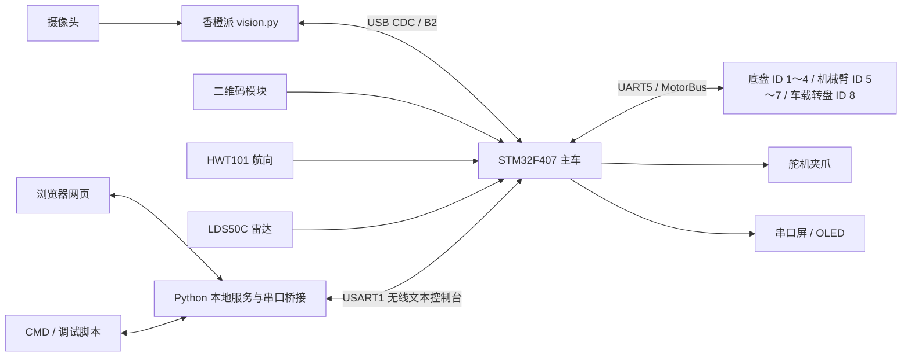

# STM32F407VGT6 搬运小车：项目总结与 AI 开发交接

更新日期：2026-10-04。用途：把本文件交给其他 AI，使其了解项目现状、找到代码入口，并在用户下一次具体需求下继续修改。

本文依据当前工作区源码、现行 README、协议及用户已确认条件整理。它是项目上下文快照；接手时仍需核对实际源码和根目录 `AGENTS.md`，有日期的旧记录不能代替当前实现。

## 1. 项目目标与当前阶段

本项目是一辆面向工训赛事的自主搬运小车，主控为 STM32F407VGT6。最终目标是：读取二维码任务码，按颜色顺序从原料区取料，经车载仓运输，在粗加工区放下并取回，在暂存区完成第一批平放和第二批同色码垛，最后返回启停区并显示统计。

任务码为 `AAA+BBB+CCC+DDD` 四组三位数字：AAA 为第一批颜色顺序，BBB 为第一批粗加工/暂存位置，CCC 为第二批颜色顺序，DDD 为第二批粗加工位置；第二批暂存按第一批同色位置码垛。颜色编号为 1 红、2 黄、3 蓝、4 绿、5 黑、6 浅蓝，位置编号为 1～3。完整目标流程为：

```text
出发 → 扫码 → 第一批原料抓取入仓 → 粗加工放置/取回
     → 暂存第一层放置 → 第二批原料抓取入仓 → 粗加工放置/取回
     → 暂存第二层同色码垛 → 返回启停区
```

**当前阶段是模块联调和局部流程集成。** 已具备底盘、航向与位置估计、视觉对准、单件取放、三仓转盘、雷达建图/规划、本地控制台和显示的软件实现。用户已确认 `align` 实车完整验证；完整两批赛事调度及自动码垛仍待完成，不能由已有路线或单件动作推定整场比赛已打通。

## 2. 接手 AI 的阅读顺序

| 顺序 | 文件 | 要了解什么 |
|---|---|---|
| 1 | [根目录 AGENTS.md](../AGENTS.md) | 用户协作约定、已确认硬件、授权范围、构建与修改边界；接手必读 |
| 2 | [根目录 README.md](../README.md) | 活动工程入口与当前能力 |
| 3 | [当前上位机协议](上位机协议.md) | 命令、参数、单位、状态、完成条件和异常原因 |
| 4 | [本地控制台手册](../Code/upper-computer-web/local-car/README.md) | 网页页面、串口共享、参数与地图操作 |
| 5 | `Code/template/Core/Src/main.c` | 初始化、主循环顺序、各业务模块如何实际接入 |
| 6 | 本次需求涉及的 `.c/.h`、测试和模块 README | 在实现前核实具体数据流，避免仅依据本文改代码 |

先执行 `git status --short` 并阅读相关 diff。本次总结前工作区已有雷达固件、网页、桥接、测试、README、协议及工具配置的未提交修改，还新增了 `radar-live.mjs` 和对应测试；接手时应以实际状态为准，保留已有工作，不能只看 HEAD 版本。

## 3. 系统组成与数据流

STM32 使用 STM32 HAL 裸机主循环，各任务通过 `Process()` 非阻塞推进。香橙派负责图像处理，F407 负责运动、取放、雷达建图与实车规划。电脑网页是调试操作端，核心控制运行在主车。



主循环关键顺序为：控制台接收与停车处理 → MotorBus / RadarScan / Camera → 机械臂和车载转盘 → 视觉业务与 IMU → 航向、定位、运动、路线 → GrabRoute / GrabTask → 速度下发、遥测、雷达控制台、显示。修改任务时必须核对事件消费与调用顺序，不能绕过现有共享总线自行发送运动指令。

网页由 HTML、CSS、JavaScript ES modules 构成，运行服务与共享串口桥接使用 Python。Node.js 用于网页模块回归测试；启动控制台无需 npm 安装或云部署。

## 4. 目录与代码定位

仓库本机位置：`C:\Users\xjx\Desktop\Code\STM32F407VxT6\模版搭建`。全部活动代码、测试、工具和参考工程位于 `Code/`。

| 位置 | 职责与入口 |
|---|---|
| `Code/template/` | F407 主车；Keil `MDK-ARM/template.uvprojx`，Target `template` |
| `Code/template/Core/` | CubeMX 结构、主程序与外设初始化 |
| `Code/template/App/` | 控制台、运动、视觉、取放、路线和雷达业务 |
| `Code/template/Hardware/` | 电机总线、Emm、雷达 UART/解析、相机协议、二维码、IMU、屏幕等驱动 |
| `Code/template/System/` | 无业务含义的公共功能 |
| `Code/orange_pi/vision.py` | 用户 2026-10-02 提供的最新香橙派 B2 视觉源码 |
| `Code/HMI/` | `display.HMI` 与配套 `.zi` 字库 |
| `Code/upper-computer-web/local-car/` | 本地控制台；启动入口 `start.cmd` |
| `Code/物料台转盘/turntable/` | 独立 F103 物料台转盘；Keil Target `turntable` |
| `Code/tests/` | F407 主机回归 |
| `Code/tools/` | 共用工具；雷达 C 规划离线入口、诊断解包等 |
| `Code/reference/` | GongXun、雷达 F1/C# 等参考项目，非活动固件入口 |
| `docs/` | 现行协议、硬件/赛事资料、规范和有日期的开发记录 |
| `.embeddedskills/` | 工具配置、构建/测试/通信日志；其中仅提交 `config.json` |
| `tmp/` | 临时分析文件 |

### 按需求找源码

以下文件未另标目录时均位于 `Code/template/App/`，接口定义与实现一起阅读。

| 修改对象 | 首先阅读的代码 |
|---|---|
| 命令解析、手动操作与停车 | `arm_console.c/.h`、`console_rx.c/.h`、`console_tx.c/.h` |
| 电机事务、UART5 恢复与反馈 | `Hardware/motor_bus.c/.h`、`Hardware/Emm_V5.c/.h` |
| 麦轮运动学、四轮反馈与 ID | `mecanum_chassis.c/.h`、`chassis_config.h`、`motor_id_config.h` |
| 运动完成、航向、位置估计与遥测 | `chassis_motion.c/.h`、`chassis_localization.c/.h`、`chassis_observer.c/.h`、`chassis_telemetry.c/.h` |
| 固定/规划路线与动作预览 | `chassis_route.c/.h`、`chassis_route_profile.c/.h` |
| 当前单件视觉对准、取放与恢复 | **`GrabTask.c/.h`**、`mechanical_arm.c/.h`、`mechanical_arm_config.h` |
| 首件组合流程 | **`GrabRoute.c/.h`** |
| 车载三仓转盘 | `turntable.c/.h` |
| 其他视觉入口与底层协议 | `ArmVision.c/.h`、`MaterialVision.c/.h`、`Hardware/Camera.c/.h`；当前抓取流程以 `GrabTask` 为准 |
| 二维码与显示 | `Hardware/QR.c/.h`、`contest_screen.c/.h`、`oled_ui.c/.h`、`Hardware/tjc_screen.c/.h` |
| 雷达采集/解码 | `radar_scan.c/.h`、`Hardware/radar_uart.c/.h`、`Hardware/lds_parser.c/.h` |
| 雷达建图/起点/规划与协议 | `radar_map.c/.h`、`radar_start.c/.h`、`radar_console.c/.h` |
| 网页入口和通信 | `local-car/app.mjs`、`protocol.mjs`、`bridge.mjs`、`serve.py`、`serial_bridge.py`（均在网页目录） |
| 网页参数与地图/雷达 | 网页目录的 `parameter-*.mjs`、`grab-params.mjs`、`map-view.mjs`、`radar-view.mjs`、`radar-format.mjs`、`radar-live.mjs` |

## 5. 已确认硬件、单位和坐标

主车为 STM32F407VGT6，LQFP100、1 MB Flash；使用张大头 **Emm42 固件**，用户只修改电机 ID，其余驱动设置保持默认。不要把这个已确认事实重新当作未知，也不要套用 X 固件单位。

| 接口 | 引脚 | 当前用途 |
|---|---|---|
| USART1 | PA9 / PA10 | 无线 ASCII 文本控制台，空格分隔命令 |
| USART2 | PA2 / PA3 | LDS50C，921600 / 8N1，DMA1 Stream5/Channel4 循环接收 |
| USART3 | PD8 / PD9 | 串口屏 |
| UART4 | PC10 / PC11 | 二维码 |
| UART5 | PC12 / PD2 | 共享步进电机总线 |
| USB CDC | PA11 / PA12 | 香橙派 B2 颜色视觉 |
| I2C1 | PB6 / PB7 | OLED |
| I2C2 | PB10 / PB11 | HWT101，只使用 Z 轴角度，PB11 为 SDA |

电机 ID：1 左前、2 左后、3 右后、4 右前；5 Base、6 Z、7 X；8 车载转盘。ID 8 业务独立于机械臂三轴枚举。

**三个必须分清的单位关系：**

- Emm 默认 1.8°、16 细分：位置命令为 **3200 命令脉冲/电机轴圈**。
- `0x36` 实时位置反馈为 **65536 协议单位/电机轴圈**；这是已核对的协议常量，不能用 3200 替换，也不需重新设置“实测一圈为 65536”的确认门槛。
- 网页转向输入/显示用 **°/s**；底层 `chassis run` 和遥测角速度用 **rad/s**，由网页换算。距离和线速度主要用 mm、mm/s，视觉误差用像素。

地图统一为左下原点、X 向右、Y 向上，yaw 从 +X 逆时针计。历史参考只在导入时使用 `T(x,y)=(2400-y,x)`，不能再次旋转已验证的底盘、IMU 或电机方向。

当前底盘配置采用轮径 80 mm、轴距约 210 mm、轮距约 240 mm、传动比 1；这些几何数值的实测确认状态仍须看 `chassis_config.h`。轮子反馈加 IMU 得到的是位置估计，不能说已消除麦轮滑移误差。

夹爪释放 500 µs、夹取 700 µs 为用户已确认实测配置。HWT101 使用原生标定和静止验证；上电等待新鲜数据后归零并做一次 5 秒验证，失败不自动反复重试；手动原生标定为 20 秒加 30 秒验证。

## 6. 当前功能与容易误判的边界

### 6.1 底盘与路线

支持平移、横移、斜移、航向保持、地图绝对转向、四轮反馈到点和停车判定。固定路线共有 15 个业务目标，逐目标人工继续与自动推进入口保留。默认路线速度 200 mm/s、距离加减速度 300 mm/s²，转向上限 100°/s；软件线速度 5000 mm/s 和轮速 3000 RPM 上限保留，不代表带载性能已经验收。网页平移测试合速度上限为 300 mm/s，直行航向纠偏限幅为 0.15 rad/s。

右下起点首腿为 `(2250,150) → (2100,300) → (2100,1200)`，先斜移再沿 X=2100 直行，保持 90°，两阶段同属目标 1。其他长段先转向再前进/后退，工位最终 90°。暂存位在 `(425,1200)` 接驳转向，最后 75 mm 进出速度不超过 `min(启动速度,50)`。

网页旧 16 段时间模拟与实车 15 目标路线独立。当前实车动作预览调用 `chassis_route_profile.c`；网页显示 C 生成的动作，不能另写一套路线逻辑后自动驱动车辆。

### 6.2 视觉对准、单件取放与三仓盘

`align` 与 `pick` 共用获取坐标、协同对准、停稳确认和短漏检恢复。`align` 到位后留在 HOLD；`pick` 在满足夹取条件后下降、抓取并入仓。**用户确认过 `align`，这不等于当前全部 `pick`/出仓/放置已完成实物验收。**

对准完成默认要求至少 3 次新的有效坐标观测、持续 200 ms、满足误差窗口且相关机构/底盘反馈停稳；进入停车阶段后重新积累，重复快照不能当新帧计数。`GrabTask` 根据 CX/CY 与自身准心重新计算误差，默认准心 `(334,338)`、矩阵 `[[2,0,0],[0,2,2]]` 属于初始控制模型，2 px/mm 不代表实测标定；旧 `ArmVision` / `MaterialVision` 标定不会更新这个矩阵。

已有单件动作包括原料入仓、粗加工取回入仓、车载取出后向粗加工或暂存第一/第二层竖直释放，并返回保存的外侧观察姿态。只检查当前场景需要的参数，未标定其他场景不能无依据地阻断首仓原料测试。

ID 8 三仓盘与电机 1∶1 直连。人工对齐首仓后读取反馈建立软件参考，不自动回零或清零；第二、第三仓角度尚未标定，不能预填 120°。上电库存待人工核对，后续库存由人工确认与软件动作维护，不能视为夹持传感器已证明物料真实存在。

普通停止、取消与 `bus recover` 保留有效配置。手动 HOME/ZERO、Base 移动及放置转向可能影响相关参考；当前诊断会标明缺项和失效原因，按现有流程恢复，不能把普通停止改成默认重新标定/全轴回零。

香橙派最新本地入口为 `Code/orange_pi/vision.py`，先 HSV 颜色粗定位，再色环精定位。B2 请求为 `FF B2 Color FF`，回复为 14 字节有效性、中心和偏差帧。B2 没有远端帧序号、采集时间或阶段字段，STM32 新鲜度按本机接收信息判断。相机请求 640×480、120 FPS，发送上限 50 Hz，实际速度取决于采集与处理；不能据配置宣称实际帧率。

```text
回复：FF B2 Color Valid CX_H CX_L CY_H CY_L DX_H DX_L DY_H DY_L SUM FE
Valid：1 有效、0 未检测到；CX/CY 为 uint16 大端像素坐标。
DX = CX - 准心X，向右为正；DY = 准心Y - CY，向上为正，均为 int16 大端。
SUM = B2 到 DY_L 的字节和低 8 位，属于累加校验。
```

本地视觉源码更新不等于香橙派实机部署。默认保持现有 B2 及实机视觉程序；不要恢复旧 CRC 协议、B3 圆环编号接口或退役脚本 `change.py`、`test_connect.py`。

### 6.3 二维码与首件组合流程

真实二维码模块已通过 UART4 接入，能解析、查询和显示任务码。但 `GrabRoute` 当前组合流程仍为：到扫码位 → 使用模拟码 `156+123+516+231` → 等待屏幕发送 → 到首原料位 → 红色首件 `pick` → 一件入仓后结束。

`grab route` / `radar task start` 没有自动启动第二件，也未将真实二维码驱动完整两批调度。工位交接按 `station/visit=5/1`（扫码）、`4/2`（首原料）判断，不能按绕障后变化的路点下标触发。

### 6.4 雷达建图、规划与实时预览

F407 静止采一个完整圈，筛选投影到 5×5 判障网格，再生成工位路线。网页与离线工具复用 `radar_map.c`、`radar_start.c`，不能另外实现一套不同的建图/路线算法。

- `radar scan upper|lower|auto` 都是单圈采集；完整圈或 10 秒超时后请求 `LSTOPH`。坏帧、单位变化或 DMA 覆盖只重采当前不完整圈，在原窗口内继续恢复，没有固定恢复次数上限。
- 自动起点比较右上 `(2250,2250,270°)` 与右下 `(2250,150,90°)`，检查二维码前 bit14、原料台前 bit22 的原始冲突；唯一无冲突才选定，两者均无冲突或均冲突时保持待定，并支持同圈人工选择。
- 名义下方雷达参考为 `(2170,230,180°)`，上方按安装关系推导；它不是已实测安装位姿。地图箭头表示雷达 0° 的地图方向，右上写入下方参考时减 180°。
- `radar nav start` 显式执行几何路线，`radar task start` 执行首件组合。当前右上仅建图/规划，实车执行入口仍右下。扫描、读图、规划、选起点和页面导航均不自动运动。
- `radar debug scan` 才捕获解析前原始字节，16 KB 滚动窗口、有效圈边界和冻结参数绑定同圈；下载页/CRC 齐全与设备完整圈证明分别核验，部分证据可以导出但不能混入旧点云。
- `radar live start/stop` 是独立持续预览，每圈显示 120 个角度分区的最近有效回波。它不更新障碍图或执行路线，不替换完整诊断，也不构成运行中的 SLAM。
- 地图和路径按报文预算动态分页，普通扫描完成后自动只读同步；完整点云按需读取，不作为导航前置条件。停止、失败和网页重连保留完整历史结果并标明来源/年龄。
- `radar probe` 查询新鲜序列号回复，需同时满足 MCU 发送完成和身份应答才确认查询往返；发送完成、回显或报警包不能单独证明查询成功。

当前位置估计没有雷达匹配修正链路，来自四轮反馈与 IMU。雷达采集、路线到站与精确视觉对准分别验证。

### 6.5 本地控制台、屏幕与独立 F103 转盘

网页/CMD/调试脚本经 Python 服务共享一个串口连接。`start.cmd` → `launch.py`，服务与串口业务主要在 `serve.py`、`serial_bridge.py`。网页只在用户明确操作时发命令，切页、选项草稿和重连本身不应触发参数写入或运动。

设备 `grab set` / `config <axis> ...` 修改 STM32 RAM；复位恢复烧录固件默认。网页保存的路线速度属于浏览器设置。**当前未实现这些参数的 Flash 保存和上电加载，保留 W25Q128 驱动不等于具备参数持久化。**

串口屏工程为 `display.HMI` 与 `.zi` 字库，修改页名、控件名或显示格式要同步核对 `contest_screen.c`。OLED 主要用于调试显示。

`Code/物料台转盘/turntable/` 是外部供料台的独立 F103C8T6 工程；当前双按键 direct 入口不等反馈，完成按时间估算。它不是主车 ID 8 三仓盘，不加入 F407 工程清单，也不共用下载参数。

## 7. 当前关键视觉参数

以下为 `GrabTask_Init()` 当前固件默认值，用户 RAM 调参可能改变实际运行值；判断实车运行值时以设备读回为准。现行源码优先于协议后部历史日期章节中的旧数值。

| 参数 | 当前默认 | 含义 |
|---|---|---|
| `body_speed` | 40 mm/s | 视觉对准底盘速度限制 |
| `lambda` | 1.2 s⁻¹ | 对准比例响应 |
| `accel` | 60 mm/s² | 对准加速度 |
| `x_speed` | 10 mm/s | X 轴速度 |
| `z_speed` | 约 55.5556 mm/s | 当前 Z 尺度下对应 500 RPM；自动下降与提起共用，不改回零配置 |
| `vision_wait_ms` | 12000 ms | 初次等待颜色、停稳后重新获取窗口 |
| `age_ms` | 1000 ms | 坐标新鲜度配置，与完成判据分开 |
| `loss_grace_ms` | 250 ms | 短漏检宽限配置 |
| `dx_tol` / `dy_tol` | 各 5 像素 | 对准误差窗口 |
| `frames` / `stable_ms` | 3 次 / 200 ms | 新坐标稳定观测与持续时间 |

`RecoveryUsed` 是诊断计数，成功重新获取不能因累计两次而整任务退出。`retries=2` 则另用于停稳后偏离窗口的 `alignment_drift` 修正，不能混同视觉重获计数。运动阶段允许按现有规则短时复用最近有效速度/方向，夹取前仍需新鲜坐标与机构反馈；不能反复把同一旧误差当新测量累加移动。

## 8. 继续修改时必须保留的工程约定

以下是便于单文件交接的摘要，完整约定见 `AGENTS.md`。

1. 用户负责需求、关键取舍和实物验收；AI 负责方案、全部代码、集成、软件测试与文档。明确修改请求授权相关实现，不要求用户逐函数批准；只要求分析时不擅自改行为。
2. 以实车完成率、动作连续性、定位效果和操作效率评价修改。新增互锁/超时/退出条件须针对具体故障，并核算误触发和恢复成本，不堆叠泛化保护。
3. 单次漏检、低帧率、通信抖动优先短时恢复，恢复后继续原任务；不要随意因固定次数耗尽而整任务失败。
4. 普通停止、总线恢复和网页重连不无依据清除配置、参考、库存与进度；确需失效时只处理受影响范围并解释原因。人工停车响应、机械边界和真实驱动故障处理仍需保留。
5. 保持直观 C、现有命名和 HAL 风格；同步头文件、调用点、必要测试、Keil 清单及现行文档，避免无关重构和通用框架。
6. 默认只维护和验证 Keil。EIDE 本轮暂缓维护，不改、不构建，也不能声称已同步。完整保留官方 `Emm_V5.c/.h`、W25Q128 驱动及默认关闭的读 ID 诊断；不要顺带删改。
7. `template.ioc`、芯片、引脚、时钟、地址和工具链改变必须属于明确需求，不顺带重新生成代码。参考项目的参数不能覆盖当前主车。
8. 软件分析、测试和构建可直接做。烧录、复位、擦除、写内存、串口/CAN 数据发送需要明确用户意图和完整硬件参数；不猜测 COM 号、调试器或下载地址，也不重复确认用户已确认的驱动配置。
9. 停车请求、命令受理、发送完成、反馈确认、软件动作完成和实物成功分别表述。网页断开或无线失联不能当作停车保证。
10. 现有 UART5 首发前单独 FE 恢复例外范围很窄；首次发送后及手动恢复不重新开放。故障日志 `owner=8/addr=0/func=0` 为无历史事务标记，不能解释成 ID 8 转盘故障。

## 9. 构建、运行与验证入口

### 主车构建

默认使用 Keil 打开 `Code/template/MDK-ARM/template.uvprojx`，Target 为 `template`。若接手环境有对应 skill，可使用 `keil`。不要为了做本地构建而擅自维护 EIDE、安装新固件框架或构建参考项目。

### 本地控制台

Windows 启动 `Code/upper-computer-web/local-car/start.cmd`，访问 `http://127.0.0.1:8765/`。依赖 Python 3 和 pyserial；没有 npm 安装要求。已有服务时，源码变更后应重启对应旧服务以加载新逻辑。

串口必须由用户从设备列表选择，无默认/自动选择 COM 号；通信格式默认 115200 / 8N1。网页串口与 `.embeddedskills/config.json` 的工具配置独立，实际操作前核对。

### 软件回归

在仓库根目录运行，按修改模块选择必要检查：

```powershell
# F407 主机模拟，需要 Python 与 GCC
python Code/tests/run_firmware_tests.py

# 网页 ES modules，需要 Node.js
node --test Code/upper-computer-web/local-car/tests/*.test.mjs

# Python 桥接及相关服务测试
python -m unittest discover -s Code/upper-computer-web/local-car/tests -p 'test*.py'

# 雷达报文契约
python Code/tests/radar_wire_contract_test.py

# 独立 F103 转盘主机回归
python Code/物料台转盘/turntable/tests/run_tests.py
```

网页测试在网页目录 `tests/`，转盘测试在独立工程 `tests/`。诊断 JSON 解包入口为 `python Code/tools/radar_capture_unpack.py <诊断JSON>`。测试与构建日志存入 `.embeddedskills/`；不删除用户已有日志或分析证据。

本次仅整理交接文档并核查引用，不构建、运行回归、连接串口或操作硬件。因此本文没有宣称当前工作区所有检查已经通过；后续修改须执行相关验证并区分既有失败与本次回归。

## 10. 未完成项与接续方向

- 车载第二/第三仓角度、车载 X 位置及各场景取放位置的实物标定和连续多件验收。
- 真实二维码、两批颜色/位置顺序、仓位库存、工位交接的完整调度。
- 粗加工取回、暂存第一层精度、第二层同色码垛和全路线重复运行验收。
- 雷达实际安装位姿、判障、路线净空与到站误差的实车核对；运行中 SLAM/雷达定位闭环尚未实现。
- 参数 Flash 持久化、EIDE 修整等属于单独需求，不能因本文件列出就视为已授权实施。

以上是现状说明，下一轮应以用户具体需求确定范围，不默认开始所有待完成项。旧 JY61P、软件漂移补偿、Flash 参数方案、旧网页协议、旧视觉入口与历史路线记录只作追溯，不应直接恢复到活动工程。

## 11. 可以直接发给其他 AI 的开场说明

```text
你正在接手我的 STM32F407VGT6 工训搬运小车项目。
请先阅读《项目总结与AI交接.md》和仓库根目录 AGENTS.md，再检查 git status 与相关源码。
我的本次具体需求是：[在这里填写要修改的功能、问题或预期现象]。

保留已有未提交修改；按当前源码、现行协议和已确认硬件条件实施。
默认只维护 Keil，不改 EIDE、IOC、引脚/时钟、官方 Emm/W25Q128 或实机香橙派程序。
优先任务完成与短暂异常恢复，不增加没有具体依据的退出门槛或全系统重置。
完成必要代码、调用点、测试和文档；报告修改内容、验证结果和仍需实车验收的部分。
硬件操作按我的明确指令和实际参数进行，不猜测串口、调试器或地址。
```

若接手 AI 只能看到本文件，尚不能访问仓库，本文可用于理解背景，但具体改动仍需提供相关源码与测试；不要根据概览猜出整份实现后覆盖现有代码。
